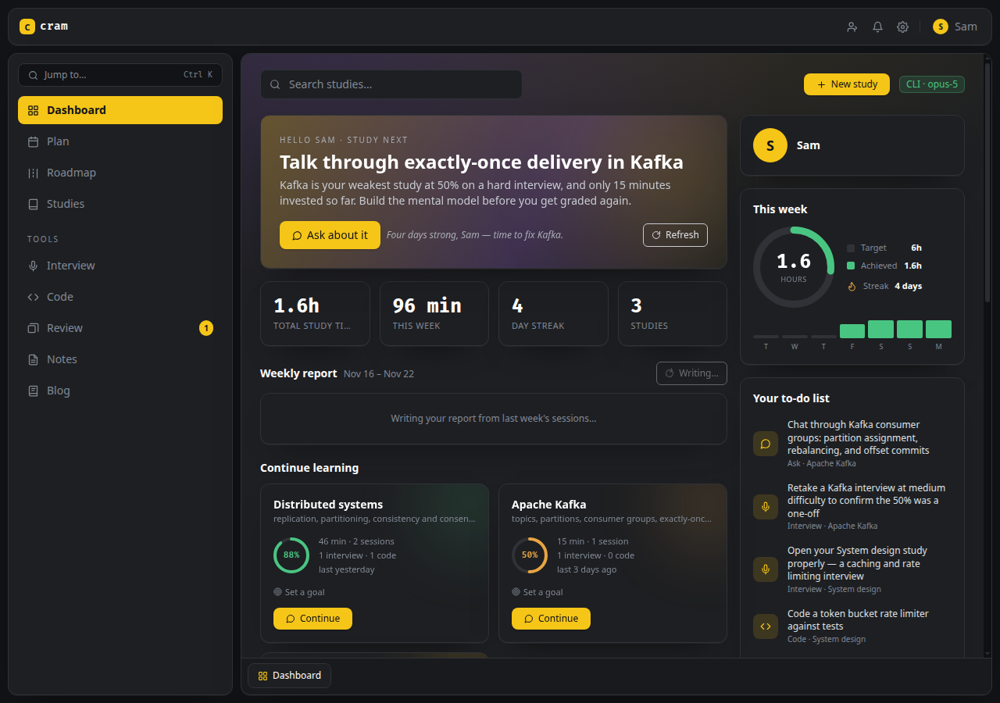
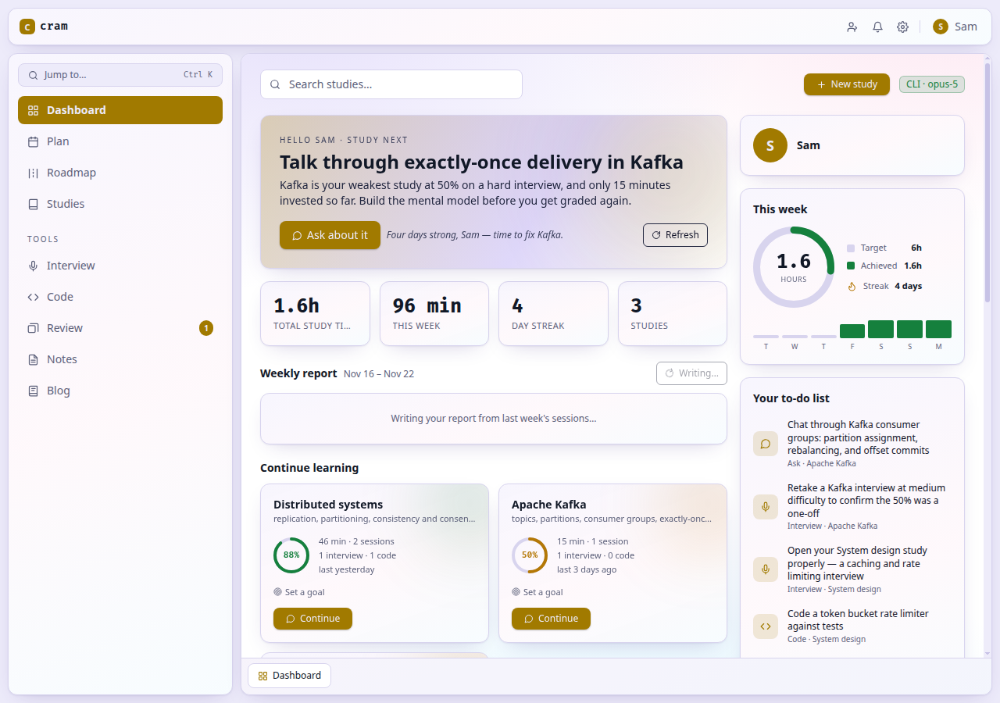
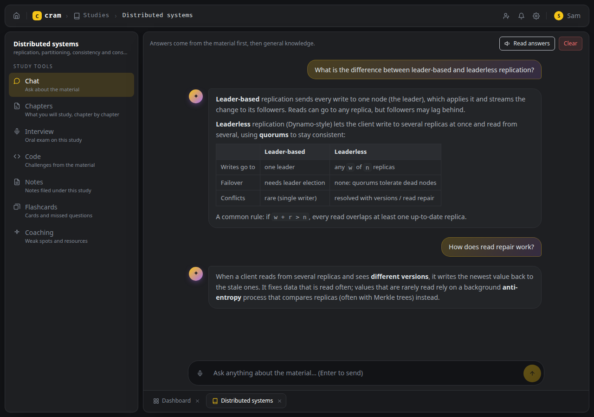
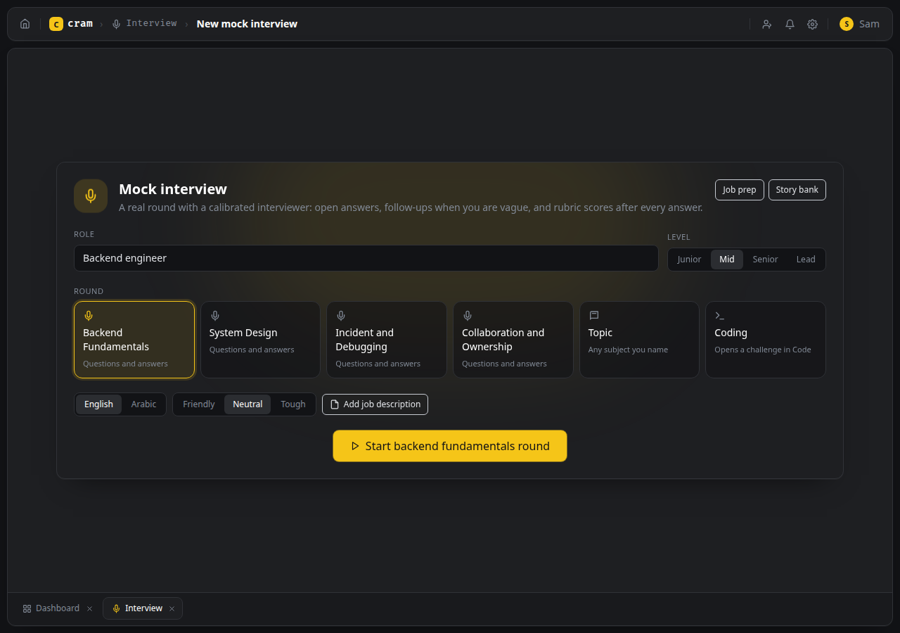
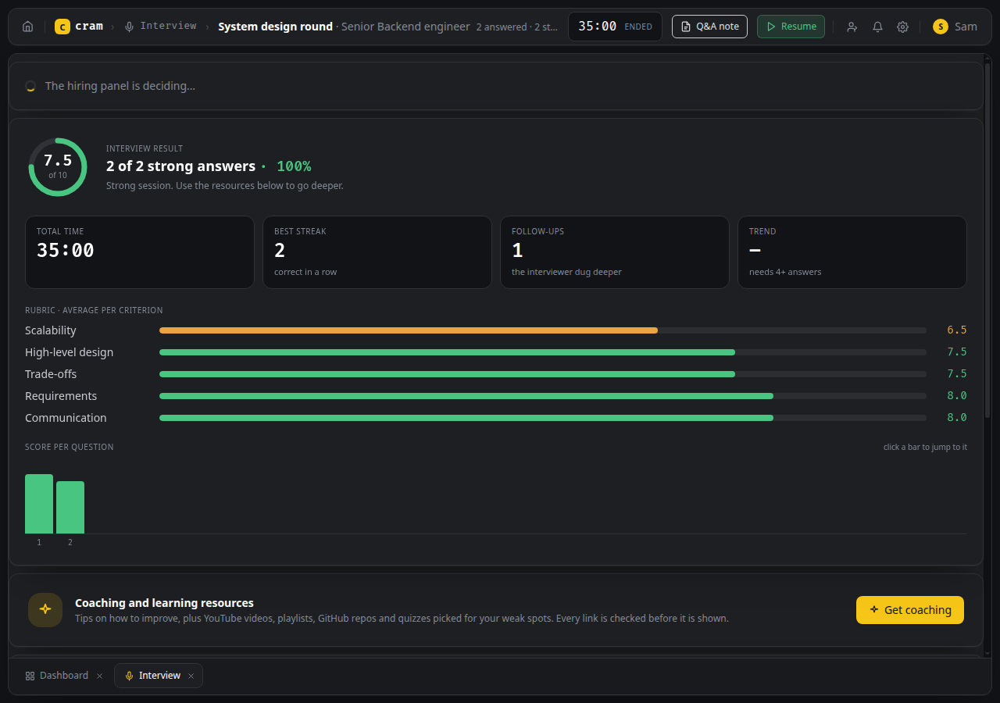
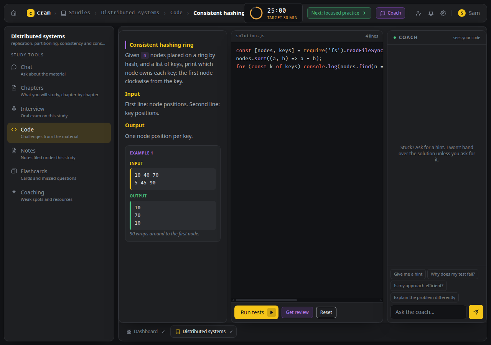
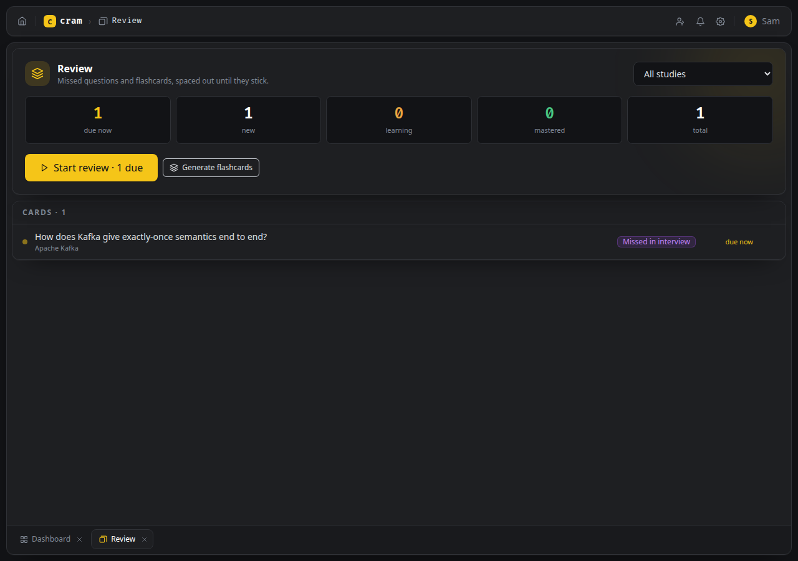
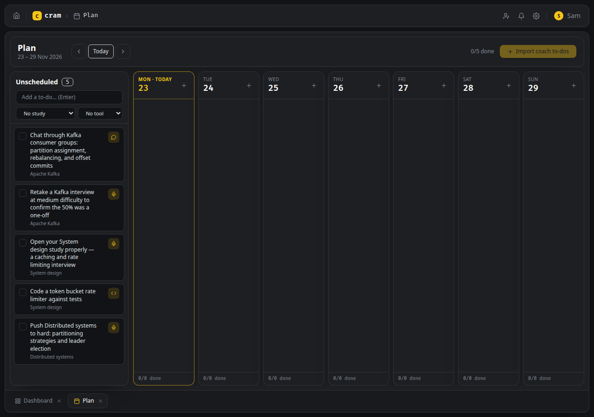
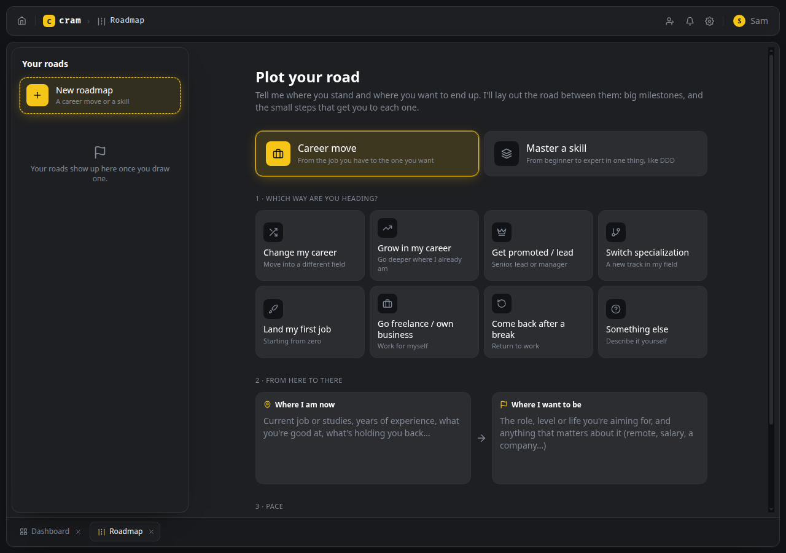
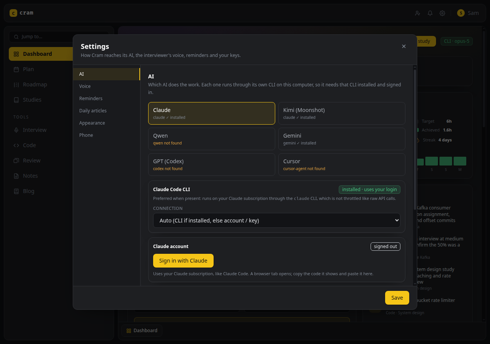

# Cram

**A study desk with an AI tutor, a voice interviewer and a coding coach, all in one place.**

Start a study from a PDF or just a subject's name. Cram then helps you learn it: ask questions about it,
follow a chapter plan, get interviewed out loud, solve coding challenges graded by real tests, and review
what you missed until you remember it. It runs on your own computer as a desktop app (Electron), and the
same app is reachable from your phone as a home-screen web app.



> Screenshots use invented demo data (the learner "Sam" and three sample studies).

---

## Contents

- [Features](#features)
  - [Dashboard and AI coach](#dashboard-and-ai-coach)
  - [Studies: chat with the material](#studies-chat-with-the-material)
  - [Mock interviews](#mock-interviews)
  - [Code arena](#code-arena)
  - [Review (spaced repetition)](#review-spaced-repetition)
  - [Plan and Roadmap](#plan-and-roadmap)
  - [Notes, Blog, Job prep and Story bank](#notes-blog-job-prep-and-story-bank)
  - [Voice](#voice)
  - [Profiles and roles](#profiles-and-roles)
  - [Reminders](#reminders)
  - [Phone](#phone)
- [Which AI it uses](#which-ai-it-uses)
- [Install](#install)
- [Run from source](#run-from-source)
- [Optional: speech to text](#optional-speech-to-text)
- [Configuration](#configuration)
- [Where your data lives](#where-your-data-lives)
- [Project layout](#project-layout)
- [Building a release](#building-a-release)
- [Self-tests](#self-tests)
- [License](#license)

---

## Features

### Dashboard and AI coach

The dashboard shows your total study time, minutes this week against your weekly target, your day streak
and every study with its average score. An **AI coach** reads those numbers and writes:

- **Study next**: the one thing worth doing now, with a button that takes you straight there.
- **A to-do list**: concrete sessions (chat, interview, code), each linked to its study.
- **How to get better**: tips based on your weak spots.
- **A weekly report** every Monday that compares last week with the week before.

Light and dark themes are both built in:



### Studies: chat with the material

A study is either a **PDF** (up to 30 MB) or a **subject** you name ("Apache Kafka", "DDD", "Cardiology
basics"). Each study has its own workspace:

| Tool | What it does |
|---|---|
| **Chat** | Ask anything. Answers come from the material first, then general knowledge, rendered as Markdown with tables and code. Each answer suggests follow-up questions. **Read answers** speaks them aloud. |
| **Chapters** | A chapter-by-chapter plan of the material. For a PDF it follows the book, and for a subject it is planned from scratch. |
| **Interview** | An oral exam on this study, optionally focused on one chapter or a page range. |
| **Code** | Coding challenges built from the material. |
| **Notes** | Rich-text notes filed under this study. |
| **Flashcards** | Generated cards plus every question you missed. |
| **Coaching** | Weak spots and learning resources (YouTube, playlists, GitHub repos, quizzes). Each link is checked against its host before it is shown. |



### Mock interviews

Practice a real interview round for a role and level, in **English or Arabic**, with a **friendly, neutral
or tough** interviewer:

- **Rounds**: technical, behavioral, situational, management, system design (staged from requirements to
  scale), architecture, coding, and **Topic** (any subject you name, such as "Kafka" or "Laravel"). When your profile
  has a derived role, the rounds fit that role: a nutritionist gets a client consultation, not system design.
- **Consultation rounds**: for client-facing jobs, Cram plays the patient, client or customer, and you run
  the encounter.
- **Job description**: paste a posting and the questions are tailored to it.
- **Follow-ups**: a vague or shallow answer gets probed, the way a real interviewer would. After two
  follow-ups on one thread, the interviewer moves on.
- **Grading**: every answer is scored 0-10 against a rubric for that round, with feedback on what landed,
  what was missing and what a strong answer at your level would include. A hint costs 2 points.
- **Delivery**: spoken answers also measure pace (words per minute), filler words and long pauses.
- **After the round**: a hiring-panel decision, a model answer for any question, the option to answer a
  question again, and coaching with checked learning resources. Any ended session can be resumed.

The next question is written while your last answer is being graded, so the conversation keeps moving.





### Code arena

HackerRank-style challenges with a problem statement, examples, a code editor and hidden tests. Choose
the language, difficulty and topic. **Run tests** executes your code locally. A **coach** that sees your
code gives hints without handing over the solution unless you ask, and **Get review** critiques a working
answer. The timer tracks the suggested time: 15, 30 or 45 minutes.

Languages: JavaScript, TypeScript, Python, PHP, Java, C++, C# and Rust. The matching compiler or runtime has to be
installed on your computer for each one.



### Review (spaced repetition)

Every question you missed in an interview, plus any flashcards you generate, joins one review queue.
Cards are spaced out (new → learning → mastered) until they stick. You can filter the queue by study.



### Plan and Roadmap

- **Plan**: a weekly board. Import the coach's to-dos with one click, add your own, and drag them onto
  days.
- **Roadmap**: describe where you stand and where you want to end up, as either a career move (change
  career, get promoted, land a first job, switch specialization and so on) or mastering one skill. Cram
  lays out the milestones and the small steps to each one, and any step can become a study.





### Notes, Blog, Job prep and Story bank

- **Notes**: a rich-text editor (Tiptap) with tables and highlighted code blocks, organized in a tree. A
  study's notes can be exported. An interview can be turned into a Q&A note.
- **Blog**: articles written for your studies and goals. Generate one on demand, or let Cram write two a
  day while it is open. Each article keeps its own discussion thread.
- **Job prep**: compare your CV with a job description to get a fit score, strengths, gaps, company
  research and a practice plan. Its flashcards join the review queue.
- **Story bank**: your STAR stories. Behavioral-style rounds ask about them and coach you on them.

### Voice

Interviews can run entirely by voice:

- **Speaking (text to speech)**: pick the engine and the voice, with previews:
  - **Edge**: Microsoft's neural voices. Free, and needs no key.
  - **Gemini**: built-in voices plus Google's voice library, including Egyptian Arabic voices.
  - **ChatGPT** (OpenAI `gpt-4o-mini-tts`).
  - **ElevenLabs**: your own voice library, with a backup key.

  If the chosen engine fails, Cram falls back to Edge, then to `espeak`. The interviewer speaks one
  sentence at a time, so it starts talking sooner.
- **Listening (speech to text)**: a local [faster-whisper](https://github.com/SYSTRAN/faster-whisper)
  worker that runs on your machine (GPU if available, otherwise CPU). It is tuned for English and for
  Egyptian Arabic mixed with English technical terms. See [Optional: speech to text](#optional-speech-to-text).

### Profiles and roles

Several people (or several goals) can each have their own **profile**, with separate studies, notes,
stories and progress. During onboarding you say what you do and what you are aiming for. The model then
derives a **role** once: whether you write code, whether you see clients, and which interview rounds fit.
The sidebar tools and interview rounds follow that role, and you can switch tools on and off yourself. If
the derivation fails, everything falls back to the general-purpose app, so nothing is ever blocked.

The interviewer and tutor address you with the right grammatical gender in languages that mark it, such
as Arabic. If you don't set a gender, they don't guess.

### Reminders

- Your own reminders at set times and days, shown in the app's notification bell while it is open.
- **Reminders while Cram is closed** (Linux): a cron entry runs `remind.js`. It sends a daily nudge after
  the hour you choose if you have not studied in the last 20 hours, and fires reminders at your own times.
  Switch it on in Settings → Reminders.

### Phone

Cram can be installed on Android or iPhone as a home-screen app (PWA). The phone is only a screen: your
computer does the work, so it must be on with Cram open. Settings → Phone shows the one-time link. The
server needs an access key on every request, which the link sets as a cookie. The setup uses
[Tailscale](https://tailscale.com/):

```bash
sudo tailscale serve --bg <port shown in Settings → Phone>
```

---

## Which AI it uses



Pick the AI in **Settings → AI**. Each provider runs through its own command-line tool on your computer,
so that tool must be installed and signed in:

| Provider | CLI it drives | Models |
|---|---|---|
| **Claude** (default) | `claude` (Claude Code) | Opus 5, Sonnet 5, Fable 5.1, Haiku 4.5 |
| Kimi (Moonshot) | `claude`, pointed at Moonshot with your key | K2 Thinking, K2 Turbo, Kimi Latest |
| Qwen | `qwen` | Qwen3 Coder Plus / Flash |
| Gemini | `gemini` | 2.5 Pro, 2.5 Flash |
| GPT (Codex) | `codex` | 5.1 Codex, 5.1 |
| Cursor | `cursor-agent` | Auto, Sonnet 4.5, GPT-5 |

For Claude there are two more ways in, chosen by the **Connection** setting (*Auto* tries them in this
order):

1. The **Claude Code CLI**: uses your Claude subscription and is not throttled like raw API calls.
2. **Sign in with Claude** (OAuth, like Claude Code): a browser tab opens, and you paste the code back.
3. An **Anthropic API key**, from Settings or the `ANTHROPIC_API_KEY` environment variable.

Only Claude can read a study's PDF directly. Other providers aren't given the file.

---

## Install

Prebuilt Linux packages (**AppImage** and **.deb**) are on the
[Releases page](https://github.com/TheGeekyM/cram/releases).

```bash
# Debian / Ubuntu
sudo apt install ./cram_<version>_amd64.deb

# any distro
chmod +x Cram-<version>.AppImage && ./Cram-<version>.AppImage
```

Then install and sign in to at least one AI CLI (for example
[Claude Code](https://docs.claude.com/en/docs/claude-code)), or sign in with Claude or add an API key in
Settings.

---

## Run from source

Requirements: **Node.js 20+** and npm. Linux is the main target: reminders while closed use cron, and the
packages are built for Linux. The desktop app itself is plain Electron.

```bash
git clone https://github.com/TheGeekyM/cram.git
cd cram
npm install

npm start        # build the UI and open the desktop app
npm run web      # or: build the UI and serve it at http://localhost:3000 (the URL with its key is printed)
```

| Script | What it does |
|---|---|
| `npm run build` | Build the React UI into `dist/` (Vite) |
| `npm start` | Build, then launch Electron |
| `npm run web` | Build, then run the server alone on port 3000 |
| `npm run dist` | Build an AppImage and a .deb into `release/` |

---

## Optional: speech to text

Spoken answers are transcribed by `stt.py`, a warm faster-whisper worker. It runs from its own virtual
environment, outside the app:

```bash
python3 -m venv ~/.local/share/cram-stt/venv
~/.local/share/cram-stt/venv/bin/pip install faster-whisper
# NVIDIA GPU (optional): also install the CUDA libraries into the same venv
~/.local/share/cram-stt/venv/bin/pip install nvidia-cublas-cu12 nvidia-cudnn-cu12
```

The model downloads on first use: `medium` on a GPU, `small` on a CPU.

---

## Configuration

Most settings live in the app (Settings → AI, Voice, Reminders, Daily articles, Appearance, Phone). These
environment variables are also read:

| Variable | Purpose |
|---|---|
| `ANTHROPIC_API_KEY` | Claude API key, used when no CLI or sign-in is available |
| `CRAM_DATA` | Data folder for the server (the desktop app sets it to its own folder) |
| `CRAM_STT_MODEL` | faster-whisper model name (default `medium` on a GPU, `small` on a CPU) |
| `CRAM_STT_PY` | Python interpreter for `stt.py` (default: the venv above) |
| `GITHUB_TOKEN` | Raises GitHub's limit for checking learning-resource links from 60 to 5000 per hour |

---

## Where your data lives

Everything stays on your computer as plain JSON:

- **Desktop app:** `~/.config/Cram/`
- **`npm run web`:** `./data/` next to the code (or `$CRAM_DATA`)

```
profiles.json                    which profile is active
settings.json                    AI, voice and reminder settings
access_key                       the key the phone link carries
profiles/<id>/profile.json       you: name, target, derived role
profiles/<id>/studies/<id>/      study.json (chat, interviews, challenges) and source.pdf
profiles/<id>/notes.json         notes
profiles/<id>/stories.json       STAR story bank
```

The Claude sign-in token is encrypted with the system keyring when one is available.

---

## Project layout

| Path | Role |
|---|---|
| `main.js` | Electron entry: window, data folder, keyring, file picker |
| `server.js` | Express API: studies, chat (streamed), interviews, grading, code runner, dashboard, coach |
| `features.js` | Review queue, flashcards, plan, roadmap, blog, job prep, voice, speech to text, reminders, export |
| `providers.js`, `cli.js` | The AI provider table, and the one place that spawns each CLI and reads its stream |
| `auth.js` | Sign in with Claude (OAuth PKCE) |
| `voiceProviders.js` | Edge, Gemini and OpenAI text to speech |
| `profiles.js`, `roles.js`, `rounds.js` | Profiles, the derived role, and the interview rounds with their rubrics |
| `linkcheck.js` | Checks learning-resource links against their hosts before showing them |
| `remind.js`, `reminderStore.js` | Reminders that fire while the app is closed (cron) |
| `stt.py` | Local faster-whisper worker |
| `src/` | React 19 + Tailwind UI (Vite): `screens/`, `components/`, `core/` |

---

## Building a release

```bash
# bump "version" in package.json, then:
npm run dist     # writes release/Cram-<version>.AppImage and release/cram_<version>_amd64.deb
```

The `build.files` list in `package.json` is an allowlist: a new top-level module has to be added there,
or the packaged app won't find it.

## Self-tests

```bash
node selftest.js            # core checks
node selftest-roadmap.js    # roadmap
node selftest-voice.js      # voice providers
```

## License

MIT
